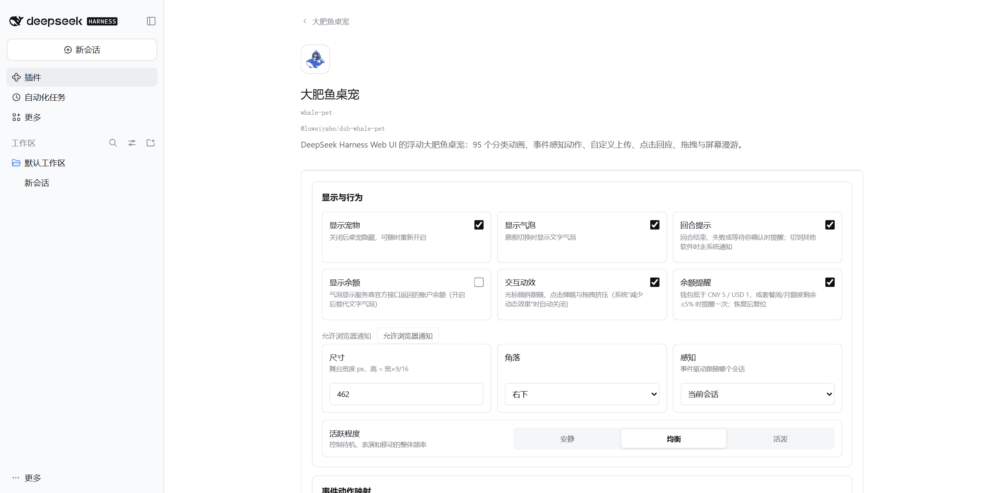
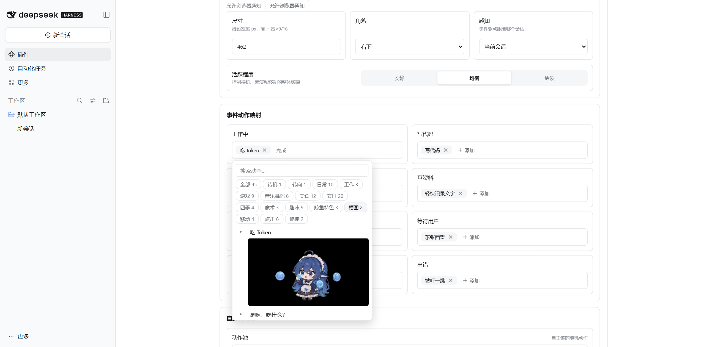
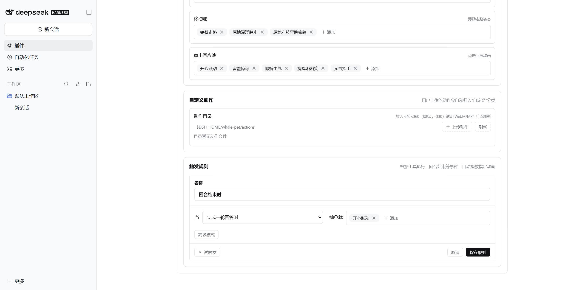
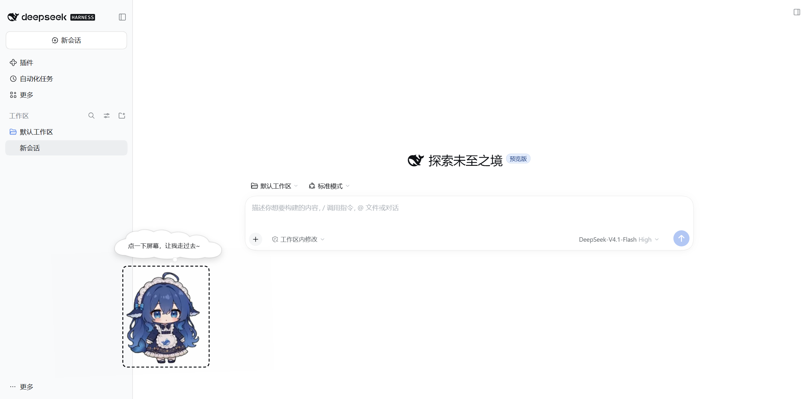
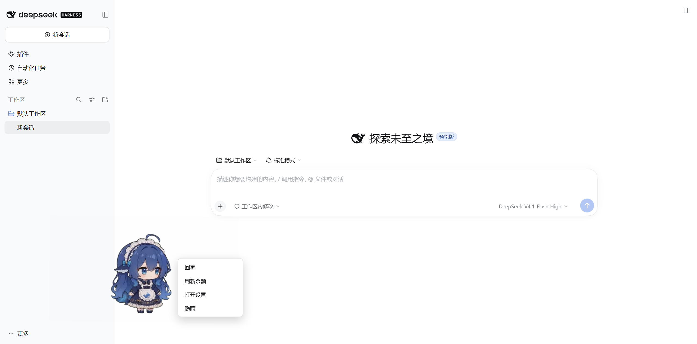
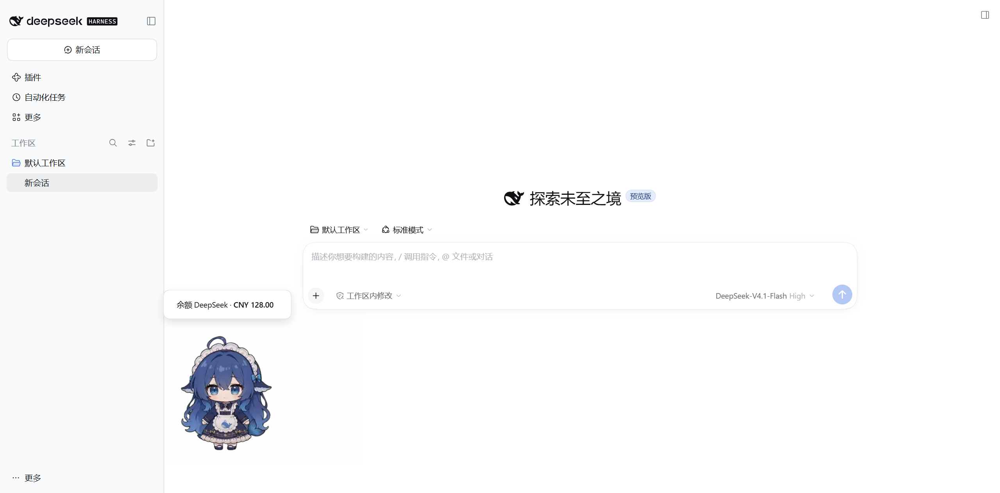
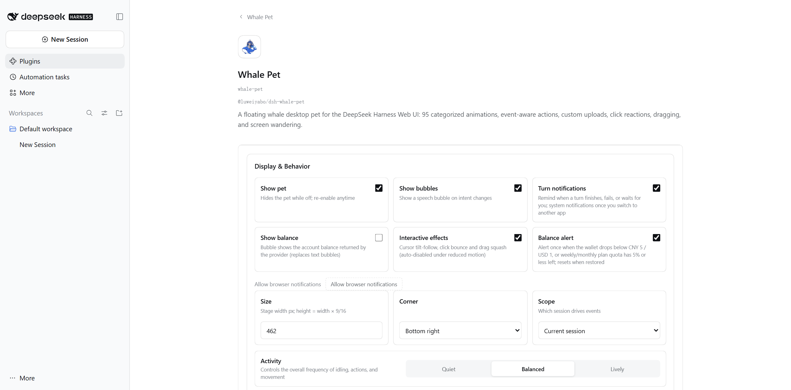

<div align="center">


# dsh-whale-pet

让鲸鱼娘住进 DeepSeek Harness：感知工作状态、回应互动，并在屏幕上自由漫游。

[](https://www.npmjs.com/package/@luweiyabo/dsh-whale-pet)
[](https://www.npmjs.com/package/@luweiyabo/dsh-whale-pet)
[](https://github.com/luweiyabo/dsh-whale-pet/stargazers)
[](https://github.com/luweiyabo/dsh-whale-pet/issues)
[](https://github.com/luweiyabo/dsh-whale-pet/blob/main/LICENSE)
[](https://github.com/deepseek-ai/deepseek-harness)
[](https://awesome-dsh-plugin.com)

[English](https://github.com/luweiyabo/dsh-whale-pet/blob/main/README_EN.md) · [预览](#功能预览) · [安装](#安装) · [使用](#如何使用) · [功能](#功能说明) · [动作](#动作展示) · [配置](#配置与数据) · [问题反馈](https://github.com/luweiyabo/dsh-whale-pet/issues)

</div>

dsh-whale-pet 是一个面向 [DeepSeek Harness](https://github.com/deepseek-ai/deepseek-harness) Web UI 的开源鲸鱼桌宠插件。它会根据 Agent 的思考、编码、工具调用、等待和错误等状态自动切换动作，也支持点击回应、拖拽、屏幕漫游、自定义动画和触发规则。

插件包含 **95 个 640×360 透明 WebM 动画**，界面覆盖 Harness 内置的全部 8 种语言（中文、English、日本語、Español、Français、Deutsch、Русский、Português），设置修改后自动保存并热生效。

## 功能预览

### 设置与动作管理

<table>
  <tr>
    <td align="center"><br><strong>集中设置</strong></td>
    <td align="center"><br><strong>动作分类、搜索与预览</strong></td>
  </tr>
  <tr>
    <td colspan="2" align="center"><br><strong>自定义动作与触发规则</strong></td>
  </tr>
</table>

### 桌面交互与状态信息

<table>
  <tr>
    <td align="center"><br><strong>点击移动</strong></td>
    <td align="center"><br><strong>右键快捷菜单</strong></td>
    <td align="center"><br><strong>账户余额气泡</strong></td>
  </tr>
  <tr>
    <td colspan="3" align="center"><br><strong>多语言界面（8 种语言）</strong></td>
  </tr>
</table>

## 动作展示

以下按运行时分类展示全部 **16 个分类、95 个动作**。预览为 240×135、5 FPS 的低帧率循环 GIF；将鼠标悬停在图片上可查看中文动作名。

### 待机（1）

<p>
  
</p>

### 转向（1）

<p>
  
</p>

### 移动（4）

<p>
  
  
  
  
</p>

### 点击回应（6）

<p>
  
  
  
  
  
  
</p>

### 拖拽（2）

<p>
  
  
</p>

### 日常（10）

<p>
  
  
  
  
  
  
  
  
  
  
</p>

### 工作（3）

<p>
  
  
  
</p>

### 游戏（9）

<p>
  
  
  
  
  
  
  
  
  
</p>

### 音乐舞蹈（6）

<p>
  
  
  
  
  
  
</p>

### 美食（12）

<p>
  
  
  
  
  
  
  
  
  
  
  
  
</p>

### 节日（20）

<p>
  
  
  
  
  
  
  
  
  
  
  
  
  
  
  
  
  
  
  
  
</p>

### 四季（4）

<p>
  
  
  
  
</p>

### 魔术（3）

<p>
  
  
  
</p>

### 趣味（9）

<p>
  
  
  
  
  
  
  
  
  
</p>

### 鲸鱼特色（3）

<p>
  
  
  
</p>

### 梗图（2）

<p>
  
  
</p>

## 安装

### 环境要求

| 项目 | 要求 |
|---|---|
| DeepSeek Harness | `^0.1.0-rc.6 \|\| ^0.1.2-rc.1 \|\| ^0.2.0-rc.2 \|\| ^0.2.2-rc.1`（开发者预览版；Web profile） |
| Node.js | `^22.19.0 \|\| >=24.0.0`（跟随 DSH 官方要求，见 DSH `package.json` 的 `engines.node`） |
| pnpm | 可在命令行中使用；`dsh plugin` 会把插件管理命令转发给 pnpm |

插件 `0.2.0` 在保留 DSH `0.1.x` 兼容的同时，新增对 DSH `0.2.0-rc.2` 及 `0.2.2-rc` 的支持（`0.2.2-rc.5` 已实测；预发布版需要显式声明范围，见下方说明）：`0.1.x` 沿用 `connection.api` / `connection.rpc`，`0.2.0-rc.2` 的设置读写改走 typert Remote 子服务 `remote.settings`，会话活动改由 `uiSession.sessionStatus` 提供，模型流式输出经 `assistant-stream` 帧归一化，设置卡片同时适配官方插件页槽位 `plugins.row.config`。会话事件订阅、模型选择、审批与问答等待状态在两种宿主上行为一致；断线后重建状态时不会把历史消息当作新事件触发规则。余额来源按账户 / 套餐 / API-key 钱包分层：DeepSeek 账户免 API key，套餐不查钱包，API-key 钱包默认查询（可在配置文件关闭）；失败时保留上次余额并标注时间。

**平台差异**：`webm` 的透明通道依赖 VP9-alpha，Chromium 内核与 Firefox 正常；Safari 与 iOS 上的所有浏览器（均为 WebKit）会把透明视频渲染成黑底，插件会自动切换成静态帧，动作仍照常切换，只是没有逐帧动画。

### 从 npm 安装

```sh
dsh plugin --profile web add @luweiyabo/dsh-whale-pet
```

安装完成后重启 Web profile：

```sh
dsh web
```

宠物默认显示在页面右下角。

> 或者直接从 GitHub 安装：
>
> ```sh
> dsh plugin --profile web add github:luweiyabo/dsh-whale-pet
> ```

同一 Web profile 只能保留一种安装来源。切换 npm、GitHub 或本地源码版本前，请先卸载当前版本；否则多个包会同时声明 `whale-pet` loader entry，导致 DSH 启动失败。

### 从本地源码安装

在仓库根目录执行：

```sh
dsh plugin --profile web add .
```

### 更新

```sh
dsh plugin --profile web update @luweiyabo/dsh-whale-pet
```

### 卸载

```sh
dsh plugin --profile web remove @luweiyabo/dsh-whale-pet
```

卸载后重新启动 `dsh web`。用户上传的动作保存在 `$DSH_HOME/whale-pet/actions/`，卸载插件不会自动删除这些文件。

## 开发

客户端源码位于 `src/client/`：`animations.js` 管理动画目录，`activity.js` 管理事件、规则与仲裁，`notify.js` 判定通知通道（气泡/系统通知/提示音），`balance-alert.js` 负责金额与余额/额度提醒状态，`schedule.js` 负责日历与用量格式化，`host-api.js` 适配不同宿主的 API，`index.js` 保留界面与播放器。修改源码后运行 `npm run build`，同时提交生成的 `lib/client.js`；`npm run check` 会校验产物与源码一致。React 仍由 DSH 宿主提供。

```sh
git clone https://github.com/luweiyabo/dsh-whale-pet.git
cd dsh-whale-pet
npm ci
npm run build
dsh plugin --profile web add .
dsh web
```

运行测试与发布内容预检：

```sh
npm run check
npm run format:check
npm test
npm pack --dry-run
```

项目采用 DSH 双半侧插件结构：

- [`lib/index.js`](https://github.com/luweiyabo/dsh-whale-pet/blob/main/lib/index.js)：宿主侧设置、静态动画、自定义动作和余额 API
- [`lib/client.js`](https://github.com/luweiyabo/dsh-whale-pet/blob/main/lib/client.js)：浏览器侧播放、交互、意图仲裁和设置界面
- [`cordis.patch.yml`](https://github.com/luweiyabo/dsh-whale-pet/blob/main/cordis.patch.yml)：DSH bundle 挂载声明
- [`assets/plugin-logo.png`](https://github.com/luweiyabo/dsh-whale-pet/blob/main/assets/plugin-logo.png)：插件 Logo
- [`assets/thumb/`](https://github.com/luweiyabo/dsh-whale-pet/tree/main/assets/thumb)：内置透明动画
- [`docs/images/screenshots/`](https://github.com/luweiyabo/dsh-whale-pet/tree/main/docs/images/screenshots)：README 功能预览截图
- [`docs/images/actions/`](https://github.com/luweiyabo/dsh-whale-pet/tree/main/docs/images/actions)：95 个动作的低帧率循环 GIF
- [`materials/references/`](https://github.com/luweiyabo/dsh-whale-pet/tree/main/materials/references)：角色首帧与视觉参考图
- [`materials/videos/`](https://github.com/luweiyabo/dsh-whale-pet/tree/main/materials/videos)：AI 生成的源 MP4（仅用于溯源和再处理，不参与运行时播放）
- [`materials/prompts/`](https://github.com/luweiyabo/dsh-whale-pet/tree/main/materials/prompts)：动画生成提示词

欢迎提交 [Issue](https://github.com/luweiyabo/dsh-whale-pet/issues) 或 [Pull Request](https://github.com/luweiyabo/dsh-whale-pet/pulls)。提交前请确认测试通过，并避免把 API Key、私有配置或大体积源视频提交到仓库。

## 如何使用

### 基础交互

| 操作 | 效果 |
|---|---|
| 悬停 | 宠物朝向光标所在一侧，移开后恢复原朝向；拖拽或惯性滑行期间不生效 |
| 悬停（动效） | 光标靠近时宠物轻微倾向光标，可在设置中关闭 |
| 单击宠物 | 根据头部、身体或尾部区域播放不同回应，并切换选中状态；开启交互动效时会同时触发一次 Q 弹压缩回弹；选中后点击页面可让宠物前往目标位置 |
| 双击宠物 | 播放“蓝鲸现世”特殊动画并取消选中状态 |
| 拖拽与反弹 | 移动并放置宠物；拖动时按速度产生挤压拉伸形变，快速甩动后会从球形帧开始播放“变成球”动画并惯性滑行；人物边界触碰屏幕时反弹，开启交互动效时碰撞会产生 Q 弹挤压；系统启用“减少动态效果”时不滑行 |
| 完全拖出屏幕 | 宠物进入边缘隐藏状态；将指针移到对应屏幕边缘可露出召回区域 |
| 右键宠物 | 打开快捷菜单：回家、刷新余额、打开设置或隐藏；最近约 2 分钟内收到完成/待确认提示时，多出「回到完成的会话」 |

### 打开设置

进入 **设置 → 插件 → 鲸鱼桌宠**（或右键宠物选「打开设置」，插件会切到「插件」页并点开本行的「配置」），可以调整：

- 显示、文字气泡、余额显示与余额提醒（余额提醒只有一个开关；阈值、刷新间隔、API-key 授权、回合结束刷新和周/月额度阈值只能在配置文件手改）
- 交互动效（光标倾斜跟随、点击弹跳、拖拽挤压）
- 宠物尺寸、默认角落和会话感知范围
- 安静、均衡、活泼三档自主活跃程度
- 日历感知（常开）：节日/季节动画优先只在应景时间出现；若配置的池里没有任何应景动画，退回完整池（避免无动作可播）
- 工作、编码、阅读、搜索、思考、等待、倾听和错误等意图对应的动作
- 自主动作、移动动作和点击回应动作池
- 自定义动作上传、预览和删除
- 自定义事件触发规则

设置页的标题、描述、行摘要和全部开关文案跟随 Harness 的界面语言（中文、English、日本語、Español、Français、Deutsch、Русский、Português），切换语言后即时更新。

所有设置会自动保存并即时生效，无需重启。

## 功能说明

### 事件感知动作

宠物会读取 Harness 会话活动，并通过 9 类意图仲裁器选择合适动作（可配置）：

| Harness 状态 | 默认表现示例 |
|---|---|
| Agent 编码或操作文件 | 坐在电脑前编码 |
| 思考与推理 | 深度思考 |
| 阅读与检索 | 记笔记 |
| 等待审批或用户回答 | 左右张望 |
| 用户发送消息 | 侧耳倾听 |
| 工具或 Agent 出错 | 惊吓回应 |
| 没有活动 | 待机、转向、随机动作或屏幕漫游 |

高频状态变化带有去抖和消退延迟，避免连续工具调用时频繁闪切。用户交互和错误等高优先级事件可以抢占当前动画。

### 自主行为与屏幕漫游

- 无会话事件时持续运行自主动画链
- 默认概率为待机 30%、转向 10%、动作 40%、移动 20%
- 行走方向与动画朝向同步，并自动检测可用空间
- 位置按窗口比例保存，窗口缩放后仍保持相对位置
- 双缓冲视频交叉淡入，减少动作切换时的空白帧
- 交互动效层：光标倾斜跟随（rAF 弹簧）、点击弹跳、拖拽挤压拉伸与滑行/反弹 Q 弹形变，可整体关闭
- 支持系统 `prefers-reduced-motion` 设置
- 日历感知（常开）：节日动画只在节日窗口前后出现（公历 + 农历，闰月按真实历法换算，结果与系统时区无关），四季动画只在对应季节出现；池里没有应景动画时退回完整池
- 冷启动先用静态透明首帧占位，视频就绪后再淡入，不再出现空白期
- 后台标签页自动暂停视频播放；余额/额度轮询降为 5 分钟下限（余额提醒开启时），同一浏览器只保留一只宠物（多标签自动让位；`localStorage` 不可用时不做单实例协调，每个标签各显示一只）
- 拖拽落点会记住：刷新、重启、隐藏后再显示都回到原处（右键「回家」清除）

### 自定义触发规则

可以用事件条件驱动任意内置或自定义动画：

- 内置工具名匹配、工具失败、Agent 出错、回合结束和等待审批等模板
- 多条件自由组合
- 可配置优先级、冷却时间和动作保持时间
- 支持“试触发”和最近触发状态
- 与内置意图使用同一优先级仲裁机制
- 新增本地时间（`time`，`HH:MM`）与星期（`dayOfWeek`，`0` = 周日）条件，配合「大于/小于」可写作息与周末规则

### 账户余额与低余额提醒

开启 `meter` 显示余额；开启 `balance.alert` 在钱包余额或套餐额度不足时提醒。余额来源按以下顺序选择，API-key 钱包默认查询：

- **DeepSeek 账户**（已登录）：走 DSH 账户服务 `remote.account.getBalance`，不需要 API key；金额为充值 + 赠送合计。
- **套餐 / 订阅**（Kimi Coding、GLM Coding、Qwen / Xiaomi Token Plan、ChatGPT Codex、GitHub Copilot 等）：余额区显示“套餐/订阅计费，不适用余额查询”，不查钱包、不碰 key。
- **套餐额度**：Codex 读本地日志（5h/周，不联网、不读 token）；OpenCode Go 查官方接口（5h/周/月）；GLM Coding 国内站 / z.ai 国际站查官方接口（5h/周）。有额度接口时，气泡显示“5h 62% · 周 31%”，详情卡显示进度条与重置倒计时；没有接口、或接口没返回某个窗口时不伪造数字。只使用服务商官方 baseURL，自定义 baseURL 视为不支持、不发送 key。额度查询默认使用 API key；周/月额度剩余 ≤5% 时提醒一次，5h 窗口不参与提醒。
- **API-key 钱包**（DeepSeek / Moonshot / StepFun）：默认查询；key 只在宿主使用，只发往对应服务商的官方余额端点；未知路由不猜，自定义 baseURL 视为不支持、不发送 key。

低余额提醒：

- 默认阈值 CNY 5 / USD 1；跌破只提醒一次，充值回到阈值以上后复位。
- 套餐周/月额度默认剩余 ≤5% 时提醒一次；额度恢复后复位。5h 额度不参与提醒。
- 提醒通道：**系统通知优先** —— 跌破阈值时即使页面聚焦也直接发系统通知（只出气泡不够明显），同时保留页内气泡；系统通知不可用时聚焦只出气泡，失焦走提示音 + 标题圆点。页面聚焦时系统通知发送失败会退回页内气泡。
- 默认刷新间隔 60 秒；右键「刷新余额」立即查询余额与套餐额度（宿主 3s 下限）；当前会话回合结束会自动刷新一次。
- 打开会话即自动识别当前模型并拉取余额，不再需要先发一次模型请求；识别期间显示“正在识别当前会话模型”。
- 悬停余额气泡展开详情、移出收起：来源、币种与上次更新时间；金额变化带滚动动画（减少动态效果时关闭）。刷新余额和打开设置保留在右键菜单中。
- 代理：DSH 启动时读取 `HTTPS_PROXY` / `HTTP_PROXY` / `ALL_PROXY`，插件使用普通 `fetch`，不另建代理。系统代理设置不生效；不支持 SOCKS；TLS 拦截代理需在启动前设置 `NODE_EXTRA_CA_CERTS`。
- 不进行 Token 费用估算。余额提醒默认开启；设置页只保留这一个开关，其余余额参数不显示，但可手动修改 profile 的 `cordis.patch.yml` 中 `whale-pet.config.balance`：`thresholds.CNY/USD`（默认 5 / 1）、`refreshMs`（默认 60000）、`allowApiKey`（默认 true）、`turnRefresh`（默认 true）、`timeoutMs`（默认 12000）、`quotaAlert.weeklyPct/monthlyPct`（默认 5），修改后重启生效。

### 回合完成提示

回合结束、失败或等待你审批/回答时提醒。通道只有三条：页内气泡、页面不可见/失焦时的系统通知、系统通知不可用时的提示音 + 标题圆点。

- 页面聚焦时：桌宠上方出气泡并联动动画，页内只出气泡（旧的页内通知卡片与队列已移除）；其他会话带会话名，点气泡切回该会话
- 页面失焦/最小化：使用系统通知（Windows/macOS/Linux，Web 首次需允许浏览器通知；Desktop 免授权）
- 系统通知不可用：播放短提示音 + 标题 `●` 圆点（未授权、非安全上下文或无 Notification 时同理）；回到前台不再补显卡片
- 配置页「显示与行为」只有一个「回合提示」开关：勾选即提示完成/失败/待确认，系统通知与提示音按环境自动选择
- 后台会话的回合不受「感知范围」限制，切走会话也能收到完成提示
- 子代理（`subagent`）会话不提示：子代理是独立子会话，完成/失败只驱动桌宠动作，不弹气泡、系统通知或提示音

## 动作配置

完整内置动作见[动作展示](#动作展示)。动作选择器会跟随 Harness 语言显示对应语言的名称，并支持按分类、英文 ID 或中英文名称搜索；内置动作与用户上传动作都可以加入自主动作池、绑定事件意图或用于触发规则。

## 自定义动作

可以直接在设置卡片上传 `.webm` 或 `.mp4` 文件，也可以复制到：

```text
$DSH_HOME/whale-pet/actions/
```

推荐规格：

| 项目 | 要求 |
|---|---|
| 画布 | 640×360 |
| 背景 | 透明 |
| 脚底线 | y=330 |
| 格式 | WebM 或 MP4 |
| 单文件上传限制 | 64 MiB |
| 自定义动作总容量 | 512 MiB |
| 动作 ID | 使用文件名，支持中文；同名文件不会被覆盖 |

上传后的动作会进入“自定义”分类，可以加入自主动作池、绑定事件意图或用于触发规则。

上传前会读取视频元数据并提醒可能的问题：MP4 没有透明通道（背景会变黑）、画幅不是 16:9（与站位和命中区对不齐）、时长超过 15 秒、元数据读不出。提醒只作建议，不阻断上传。

## 配置与数据

插件设置保存在 DSH 的 `whale-pet` 设置命名空间，自定义动画保存在 `$DSH_HOME/whale-pet/actions/`。拖拽落点以 `posX`/`posY` 比例值保存在同一命名空间；日历相关旧字段保留在 `calendar`（设置页已不提供开关）。插件不会把动画、设置或 API Key 上传到本项目维护者的服务器。

常用环境变量：

| 环境变量 | 用途 |
|---|---|
| `DSH_HOME` | 指定 DSH 数据目录；未设置时使用 DSH 默认目录 |
| `DEEPSEEK_API_KEY` | DeepSeek 余额查询凭据来源之一 |
| `MOONSHOT_API_KEY` | Moonshot 余额查询凭据来源之一 |
| `STEPFUN_API_KEY` | StepFun 余额查询凭据来源之一 |

## 常见问题

<details>
<summary><strong>安装后没有看到宠物</strong></summary>

重新启动 `dsh web`，然后进入 **设置 → 插件 → 鲸鱼桌宠**，确认“显示宠物”已开启。也可以运行 `dsh --profile web --dump-config`，检查插件是否出现在组合配置中。

</details>

<details>
<summary><strong>宠物被拖出屏幕后找不到了</strong></summary>

把指针移动到宠物消失的屏幕边缘，宠物会露出召回区域。也可以通过插件设置重新显示，或在右键菜单选择“回家”。

</details>

<details>
<summary><strong>余额气泡显示“不支持”或“查询失败”</strong></summary>

套餐/订阅显示“套餐/订阅计费”属正常；API-key 钱包显示“需要授权”说明配置文件里关闭了查询：在 profile 的 `cordis.patch.yml` 设置 `whale-pet.config.balance.allowApiKey: true` 并重启即可（默认已开启）。网络/代理错误请检查 DSH 启动时的 `HTTPS_PROXY` / `HTTP_PROXY` / `ALL_PROXY`，TLS 拦截代理还需 `NODE_EXTRA_CA_CERTS`。

</details>

<details>
<summary><strong>自定义动作播放时背景是黑的</strong></summary>

MP4（H.264）没有透明通道，宠物会显示成黑色方块；请改用带 alpha 的 WebM（VP9 + `yuva420p`）。上传时的提醒也是这个原因。

</details>

<details>
<summary><strong>桌面端右键「打开设置」没反应</strong></summary>

两个平台行为一致：先用官方布局接口切到「插件」页，再点本插件那一行的「配置」，
直接打开配置页；当前停在别的插件页时会先返回列表。都找不到才弹提示。
旧版（0.1.x）仍走"设置 → 插件"的老路径。

</details>

<details>
<summary><strong>同时开了多个 DSH 标签页，为什么只有一只有宠物</strong></summary>

插件用 `localStorage` 心跳做单实例：只有持有心跳的标签渲染宠物，其它标签待命（设置卡仍可用）。关闭或刷新主标签后，另一个标签会在几秒内自动接替。浏览器禁用 `localStorage`（如部分隐私模式）时无法协调：每个标签都会显示宠物，也不会有主从接替。

</details>

<details>
<summary><strong>Safari 里宠物是静止的</strong></summary>

Safari（以及 iOS 上的所有浏览器）底层是 WebKit，不认 VP9 的 alpha 通道，视频会被渲染成黑底方块。
插件检测到这类环境后改用从每段动画抽首帧的静态图，黑底消失，但只有静态姿势。
需要逐帧动画请改用 Chromium 内核浏览器或桌面端。

</details>

## 资源来源与许可

- 本项目原创代码使用 [MIT License](https://github.com/luweiyabo/dsh-whale-pet/blob/main/LICENSE)
- [`assets/thumb/`](https://github.com/luweiyabo/dsh-whale-pet/tree/main/assets/thumb) 中的大部分动画资源来自 [PC2005-cloud/dsh-pet](https://github.com/PC2005-cloud/dsh-pet)，不属于本项目的 MIT 代码授权
- 上游目前允许这些动画资源用于开源项目，但禁止商业使用；使用、再分发或改编前请阅读 [第三方资源许可说明](https://github.com/luweiyabo/dsh-whale-pet/blob/main/THIRD_PARTY_ASSETS.md) 并核对上游最新条款
- 因 npm 包同时包含 MIT 代码和受单独条款约束的媒体资源，包的许可字段为 `SEE LICENSE IN LICENSE` 而非单纯的 `MIT`；根目录 [LICENSE](https://github.com/luweiyabo/dsh-whale-pet/blob/main/LICENSE)（标准 MIT）仅覆盖原创代码，媒体资源条款见随包分发的 [第三方资源许可说明](https://github.com/luweiyabo/dsh-whale-pet/blob/main/THIRD_PARTY_ASSETS.md)，不能把整个 npm 包视为纯 MIT 授权

本项目与 DeepSeek 官方无隶属关系，是面向 DeepSeek Harness 的社区开源插件。
