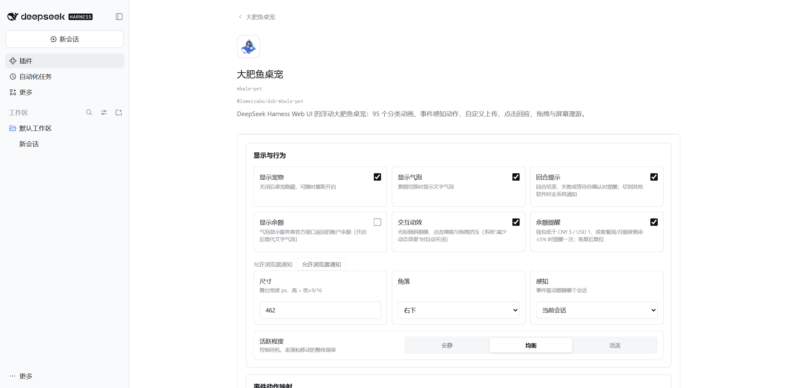
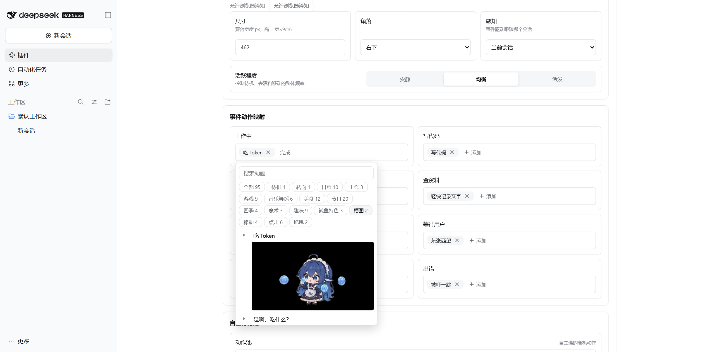
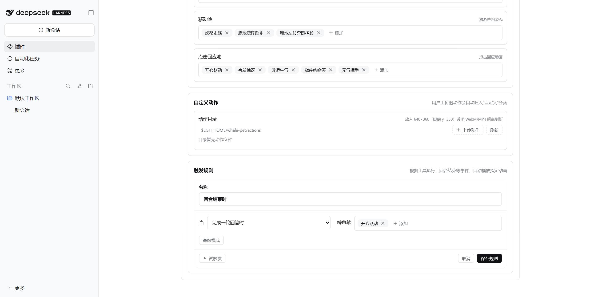
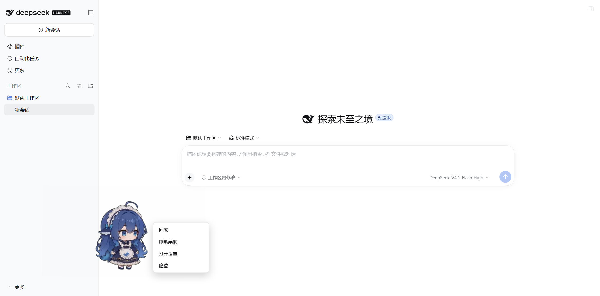
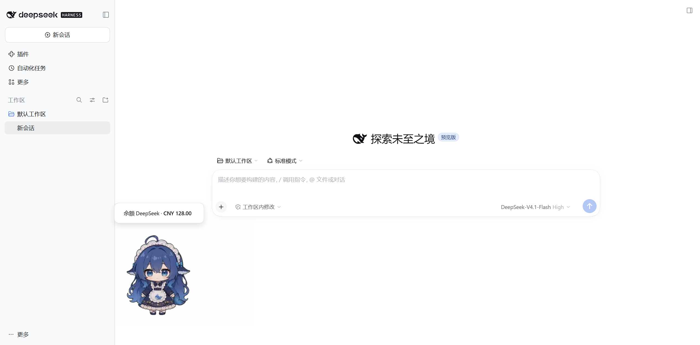

<div align="center">


# dsh-whale-pet

Bring the whale girl into DeepSeek Harness: react to agent activity, respond to interaction, and roam around the screen.

[](https://www.npmjs.com/package/@luweiyabo/dsh-whale-pet)
[](https://www.npmjs.com/package/@luweiyabo/dsh-whale-pet)
[](https://github.com/luweiyabo/dsh-whale-pet/stargazers)
[](https://github.com/luweiyabo/dsh-whale-pet/issues)
[](https://github.com/luweiyabo/dsh-whale-pet/blob/main/LICENSE)
[](https://github.com/deepseek-ai/deepseek-harness)
[](https://awesome-dsh-plugin.com)

[中文](https://github.com/luweiyabo/dsh-whale-pet/blob/main/README.md) · [Preview](#preview) · [Install](#installation) · [Usage](#usage) · [Features](#features) · [Development](#development) · [Issues](https://github.com/luweiyabo/dsh-whale-pet/issues)

</div>

dsh-whale-pet is an open-source desktop-pet plugin for the [DeepSeek Harness](https://github.com/deepseek-ai/deepseek-harness) Web UI. It reacts to agent thinking, coding, tool calls, waiting states, and errors. It also supports click reactions, dragging, screen roaming, custom animations, and event-triggered rules.

The package includes **95 transparent 640×360 WebM animations**, an interface in all eight languages Harness ships (Chinese, English, Japanese, Spanish, French, German, Russian, Portuguese), and settings that save automatically and take effect immediately.

## Preview

### Settings and action management

<table>
  <tr>
    <td align="center"><br><strong>Centralized settings</strong></td>
    <td align="center"><br><strong>Categories, search, and previews</strong></td>
  </tr>
  <tr>
    <td colspan="2" align="center"><br><strong>Custom actions and trigger rules</strong></td>
  </tr>
</table>

### Desktop interaction and status

<table>
  <tr>
    <td align="center"><br><strong>Click to move</strong></td>
    <td align="center"><br><strong>Context menu</strong></td>
    <td align="center"><br><strong>Balance bubble</strong></td>
  </tr>
  <tr>
    <td colspan="3" align="center"><br><strong>Multilingual UI (8 languages)</strong></td>
  </tr>
</table>

See the [complete gallery of all 95 actions](https://github.com/luweiyabo/dsh-whale-pet/blob/main/README.md#动作展示).

## Installation

### Requirements

| Item | Requirement |
|---|---|
| DeepSeek Harness | `^0.1.0-rc.6 \|\| ^0.1.2-rc.1 \|\| ^0.2.0-rc.2 \|\| ^0.2.2-rc.1` (developer preview; Web profile) |
| Node.js | `^22.19.0 \|\| >=24.0.0` (follows DSH's official `engines.node`) |
| pnpm | Available on the command line; `dsh plugin` delegates package management to pnpm |

Plugin `0.2.0` keeps DSH `0.1.x` compatibility and adds support for DSH `0.2.0-rc.2` and `0.2.2-rc` (verified on `0.2.2-rc.3`; prerelease versions need an explicit range, see below): `0.1.x` keeps using `connection.api` / `connection.rpc`, while `0.2.0-rc.2` reads and writes settings through the typert Remote subservice `remote.settings`, takes session activity from `uiSession.sessionStatus`, normalizes model streaming from `assistant-stream` frames, and targets the official plugin-page slot `plugins.row.config` for its settings card. Session events, model selection, and pending approvals/questions behave the same on both hosts; restoring state after a reconnect does not fire rules for historical messages. Balances are layered by account / plan / API-key wallet: DeepSeek account needs no API key, plans do not query a wallet, and API-key wallets require explicit consent; failures keep the last known balance labelled with its time.

**Platform note**: transparent WebM relies on VP9 alpha, which works in Chromium-based browsers and Firefox. Safari and every browser on iOS (all WebKit) render transparent video on a black box, so the pet switches to static frames automatically: actions still change, but there is no frame-by-frame motion.

### Install from npm

```sh
dsh plugin --profile web add @luweiyabo/dsh-whale-pet
dsh web
```

The pet appears in the lower-right corner by default.

Alternatively, install directly from GitHub:

```sh
dsh plugin --profile web add github:luweiyabo/dsh-whale-pet
```

Keep only one installation source in a Web profile. Before switching between the npm, GitHub, and local-checkout variants, uninstall the current variant; otherwise multiple packages declare the same `whale-pet` loader entry and DSH cannot start.

### Install from a local checkout

```sh
dsh plugin --profile web add .
```

### Update

```sh
dsh plugin --profile web update @luweiyabo/dsh-whale-pet
```

### Uninstall

```sh
dsh plugin --profile web remove @luweiyabo/dsh-whale-pet
```

Restart `dsh web` after uninstalling. User-uploaded actions remain in `$DSH_HOME/whale-pet/actions/` and are not removed automatically.

## Development

Client source lives in `src/client/`: `animations.js` owns the animation catalog, `activity.js` owns events, rules and arbitration, and `index.js` owns the UI and player. Run `npm run build` after editing source and commit the generated `lib/client.js` alongside it. `npm run check` verifies that the bundle matches the source. React is still supplied by DSH.

```sh
git clone https://github.com/luweiyabo/dsh-whale-pet.git
cd dsh-whale-pet
npm ci
npm run build
dsh plugin --profile web add .
dsh web
```

Run tests and inspect the npm package contents:

```sh
npm run check
npm run format:check
npm test
npm pack --dry-run
```

The project uses DSH's split host/client plugin architecture:

- [`lib/index.js`](https://github.com/luweiyabo/dsh-whale-pet/blob/main/lib/index.js): host-side settings, static animations, custom actions, and balance API
- [`lib/client.js`](https://github.com/luweiyabo/dsh-whale-pet/blob/main/lib/client.js): browser-side playback, interaction, intent arbitration, and settings UI
- [`cordis.patch.yml`](https://github.com/luweiyabo/dsh-whale-pet/blob/main/cordis.patch.yml): DSH bundle registration
- [`assets/plugin-logo.png`](https://github.com/luweiyabo/dsh-whale-pet/blob/main/assets/plugin-logo.png): plugin logo
- [`assets/thumb/`](https://github.com/luweiyabo/dsh-whale-pet/tree/main/assets/thumb): built-in transparent animations
- [`docs/images/screenshots/`](https://github.com/luweiyabo/dsh-whale-pet/tree/main/docs/images/screenshots): README feature-preview screenshots
- [`docs/images/actions/`](https://github.com/luweiyabo/dsh-whale-pet/tree/main/docs/images/actions): low-frame-rate GIF previews for all 95 actions
- [`materials/references/`](https://github.com/luweiyabo/dsh-whale-pet/tree/main/materials/references): character first frames and visual references
- [`materials/videos/`](https://github.com/luweiyabo/dsh-whale-pet/tree/main/materials/videos): AI-generated source MP4 files for traceability and reprocessing, not runtime playback
- [`materials/prompts/`](https://github.com/luweiyabo/dsh-whale-pet/tree/main/materials/prompts): animation-generation prompts

Contributions are welcome through [issues](https://github.com/luweiyabo/dsh-whale-pet/issues) and [pull requests](https://github.com/luweiyabo/dsh-whale-pet/pulls). Run the tests before submitting and never commit API keys, private configuration, or large source videos.

## Usage

### Basic interaction

| Action | Result |
|---|---|
| Hover | The pet faces the pointer side and restores its previous direction on leave; disabled while dragging or coasting |
| Hover (effects) | The pet leans subtly toward a nearby cursor; can be disabled in settings |
| Single-click the pet | Plays a head, body, or tail reaction and toggles selection; when interactive effects are enabled, each click also triggers a Q-style squash-and-bounce effect; while selected, click the page to choose a destination |
| Double-click the pet | Plays the “Blue Whale Appears” special animation and clears selection |
| Drag and bounce | Moves and places the pet; squash-and-stretch follows drag speed, and a quick throw starts the “Turn Into a Ball” animation at its ball-shaped frame and continues with momentum; the character bounds bounce off screen edges, collisions add a Q-style squash when interactive effects are enabled; momentum is disabled when Reduce Motion is enabled |
| Drag fully off-screen | Enters edge-hidden mode; move the pointer to that screen edge to reveal the recall handle |
| Right-click | Opens shortcuts for Home, Refresh balance, Settings, and Hide |

### Settings

Open **Settings → Plugins → Whale Pet** (or right-click the pet and pick "Settings", which switches to the Plugins panel and opens this row's Configure page) to configure:

- Visibility, text bubbles, account balance, low-balance alerts, and API-key consent
- Interactive effects (cursor tilt-follow, click bounce, drag squash)
- Pet size, default corner, and session-awareness scope
- Quiet, balanced, or lively autonomous activity
- Calendar awareness (always on): festival and seasonal animations only appear in their window
- Animations for working, coding, reading, researching, thinking, waiting, listening, and error states
- Autonomous, movement, and click-reaction pools
- Custom action upload, preview, and deletion
- Custom event-triggered rules

Settings are saved automatically and applied without restarting.

## Features

### Agent-aware animations

The pet reads Harness session activity and selects suitable actions through nine configurable intent arbiters:

| Harness activity | Default behavior |
|---|---|
| Coding or file operations | Coding at a computer |
| Thinking and reasoning | Deep thought |
| Reading and research | Taking notes |
| Waiting for approval or an answer | Looking around |
| User message | Attentive listening |
| Tool or agent error | Startled reaction |
| No activity | Idle, turn, random action, or roam |

Debounce and linger intervals prevent rapid animation switching. User interaction, errors, and other high-priority events can interrupt the current animation.

### Autonomous behavior and roaming

- Continuous autonomous animation chain while no session event is active
- Default probabilities: idle 30%, turn 10%, action 40%, movement 20%
- Direction-aware movement with available-space checks
- Relative position persistence across window resizing
- Double-buffered video crossfades
- Interactive effects layer: cursor tilt-follow (rAF spring), click bounce, drag squash-and-stretch, and bouncy squash during coasting/bounces, globally toggleable
- Support for `prefers-reduced-motion`
- Calendar awareness (always on): festival animations appear only around their dates (Gregorian and Chinese lunar, resolved via the system Chinese calendar); seasonal animations only in their season
- A static transparent first-frame poster covers cold starts until the first video is ready
- Background tabs pause playback and balance polling; only one pet per browser (other tabs step aside)
- The dragged position is remembered across reloads, restarts, and hide/show cycles (right-click Home clears it)

### Custom trigger rules

- Built-in templates for tool calls, failures, agent errors, turn completion, and approval requests
- Multiple conditions per rule
- Configurable priority, cooldown, and hold duration
- Test-trigger action and last-triggered status
- Shared priority arbitration with built-in intents
- New `time` (`HH:MM`, local) and `dayOfWeek` (`0` = Sunday) conditions plus greater-than / less-than operators for work-hours and weekend rules

### Account balance and low-balance alerts

Enable `meter` to show the balance and `balance.alert` to be notified below a threshold. Sources are chosen in this order, keeping API keys out of the way unless necessary:

- **DeepSeek account** (signed in): uses the DSH account service `remote.account.getBalance`; no API key. The amount is recharge + bonus.
- **Plans / subscriptions** (Kimi Coding, GLM Coding, Qwen / Xiaomi Token Plan, ChatGPT Codex, GitHub Copilot, etc.): reports "plan/subscription billing — no wallet balance" and never queries a wallet or a key.
- **API-key wallets** (DeepSeek / Moonshot / StepFun): queried only after you explicitly enable "Allow API-key queries" in Settings. The key stays in the Host and is sent only to the provider's official balance endpoint. Unknown routes are not guessed.

Low-balance alerts:

- Per-currency thresholds (CNY 20 / USD 3 by default); one alert per crossing, reset after topping up.
- Reuses the turn-notification channels: system notification / chime / card, with a bubble while the page is focused.
- Refresh interval `30s / 60s / 5min / off`; right-click "Refresh balance" queries immediately (3 s Host debounce).
- Proxy: DSH reads `HTTPS_PROXY` / `HTTP_PROXY` / `ALL_PROXY` at launch; the plugin uses plain `fetch` and never installs its own proxy. OS proxy settings are not read; SOCKS is unsupported; a TLS-intercepting proxy needs `NODE_EXTRA_CA_CERTS` before launch.
- Disabled by default; token costs are not estimated. If an older profile already enabled `meter`, allow API-key queries once after upgrading (0.2.0 is unpublished, so there is no automatic migration).

### Turn notifications

Get notified when a turn finishes, fails, or waits for your approval/answer. When the page is hidden it uses system notifications; insecure contexts (LAN over HTTP) fall back to a chime plus a dot in the tab title.

- Page focused: a bubble above the pet with a reaction animation; other sessions include their name, and clicking the bubble switches back
- Page unfocused/minimized: system notification on Windows, macOS, and Linux (grant browser permission once on the Web; none needed in Desktop)
- No system notification available: a short chime plus a `●` title marker, and the card is shown when you return
- Settings page “Turn notifications”: five switches for completion, failure, needs-input, system notifications, and the chime
- Subagent sessions never notify: a subagent is a separate child session, so its completion/failure only drives pet animations — no bubble, system notification, or chime
- Background sessions are watched regardless of the activity scope, so switching away does not lose the completion

## Action configuration

See the [complete gallery of all 95 actions](https://github.com/luweiyabo/dsh-whale-pet/blob/main/README.md#动作展示) for all built-in actions. The action selector follows the Harness language and shows names in the current UI language, with search by category, English ID, or name; both built-in and user-uploaded actions can join autonomous pools, bind to event intents, or be used in trigger rules.

## Custom actions

Upload a `.webm` or `.mp4` file in the settings card, or copy it to:

```text
$DSH_HOME/whale-pet/actions/
```

Recommended format:

| Item | Requirement |
|---|---|
| Canvas | 640×360 |
| Background | Transparent |
| Foot line | y=330 |
| Format | WebM or MP4 |
| Upload limit | 64 MiB per file |
| Total custom storage | 512 MiB |
| Action ID | Filename; Unicode is supported and existing files are not overwritten |

Uploaded actions appear under the “Custom” category and can be added to autonomous pools, assigned to intents, or selected by trigger rules.

Before uploading, the video metadata is read and possible problems are flagged: MP4 has no alpha channel (black background), non-16:9 framing (misaligned footprint and hit box), longer than 15 s, or unreadable metadata. These are advisory only and never block the upload.

## Configuration and data

Settings are stored in the DSH `whale-pet` namespace. Custom animations are stored in `$DSH_HOME/whale-pet/actions/`. The plugin does not upload animations, settings, or API keys to the project maintainer.

The settings page title, description, row summary, and all field copy follow the Harness UI language (all eight languages) and update immediately when the language changes.

| Environment variable | Purpose |
|---|---|
| `DSH_HOME` | Overrides the DSH data directory |
| `DEEPSEEK_API_KEY` | One credential source for DeepSeek balance queries |
| `MOONSHOT_API_KEY` | One credential source for Moonshot balance queries |
| `STEPFUN_API_KEY` | One credential source for StepFun balance queries |

## Troubleshooting

<details>
<summary><strong>The pet does not appear after installation</strong></summary>

Restart `dsh web`, then open **Settings → Plugins → Whale Pet** and ensure the pet is enabled. You can also run `dsh --profile web --dump-config` and confirm the plugin appears in the merged configuration.

</details>

<details>
<summary><strong>The pet disappeared after being dragged off-screen</strong></summary>

Move the pointer to the screen edge where it disappeared. You can also enable it again in settings or use **Home** from the context menu.

</details>

<details>
<summary><strong>The balance bubble says unsupported or failed</strong></summary>

A plan/subscription provider showing “plan/subscription billing” is expected; an API-key wallet showing “needs permission” can be enabled under Settings → Account balance. For network/proxy errors, check `HTTPS_PROXY` / `HTTP_PROXY` / `ALL_PROXY` at DSH launch; a TLS-intercepting proxy also needs `NODE_EXTRA_CA_CERTS`.

</details>

<details>
<summary><strong>My custom action plays with a black background</strong></summary>

MP4 (H.264) has no alpha channel, so the pet renders as a black box. Use a WebM with alpha (VP9 + `yuva420p`) instead — the upload warning reports the same reason.

</details>

<details>
<summary><strong>Right-click → Settings does nothing in the desktop app</strong></summary>

Both platforms behave the same: the pet uses the official layout API to open the Plugins panel and
then clicks the Configure control on its own row (the host labels it `Configure <name>`), which opens the
plugin configuration page directly. If another detail page is open, it goes back to the list first. Only
when that fails does it show a hint. Older 0.1.x shells keep the legacy Settings → Plugins path.

</details>

<details>
<summary><strong>Why is there only one pet when I open several DSH tabs?</strong></summary>

The plugin keeps a single instance with a `localStorage` heartbeat: only the tab holding it renders the pet, other tabs stand by (their settings card still works). After the leading tab closes or reloads, another tab takes over within seconds.

</details>

<details>
<summary><strong>Why is the pet static in Safari?</strong></summary>

Safari (and every browser on iOS) runs on WebKit, which ignores the VP9 alpha channel and shows the video on a black box. When the plugin detects such an environment it uses a still frame extracted from each animation: the black box is gone, but only static poses remain. Use a Chromium-based browser or the desktop app for frame-by-frame animation.

</details>

## Asset sources and licensing

- Original source code is licensed under the [MIT License](https://github.com/luweiyabo/dsh-whale-pet/blob/main/LICENSE).
- Most animations under [`assets/thumb/`](https://github.com/luweiyabo/dsh-whale-pet/tree/main/assets/thumb) come from [PC2005-cloud/dsh-pet](https://github.com/PC2005-cloud/dsh-pet) and are not covered by this project's MIT code license.
- The upstream project currently allows these assets in open-source projects but prohibits commercial use. Review the [third-party asset notice](https://github.com/luweiyabo/dsh-whale-pet/blob/main/THIRD_PARTY_ASSETS_EN.md) and the latest upstream terms before use, redistribution, or modification.
- Because the npm package combines MIT-licensed code with separately licensed media, its package license is `SEE LICENSE IN LICENSE` rather than plain `MIT`. The root [LICENSE](https://github.com/luweiyabo/dsh-whale-pet/blob/main/LICENSE) (standard MIT) covers only original code; the media terms are in the [third-party asset notice](https://github.com/luweiyabo/dsh-whale-pet/blob/main/THIRD_PARTY_ASSETS_EN.md) shipped with the package. The complete package must not be treated as purely MIT-licensed.

This is an independent community plugin and is not affiliated with DeepSeek.
